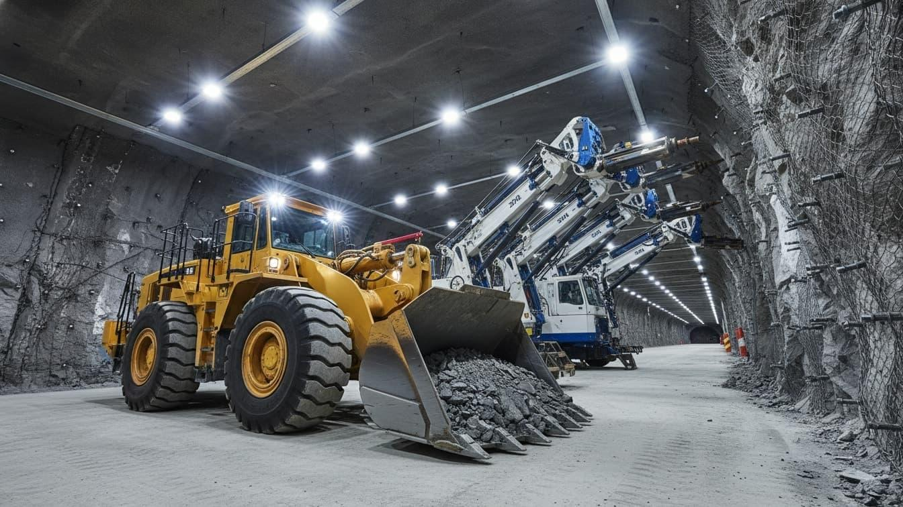

<div align="center">

  

  # MINEHUB
  ### Mining Safety Incidents & Equipment Inspections Tracking System with Grafana Overdue Alerts

  [](https://docs.oracle.com/en/database/oracle/oracle-database/)
  [](https://grafana.com/)
  [](https://www.msha.gov/data-and-reports)
  [](https://catalog.data.gov/dataset/msha-accident-injuries-data-set)

</div>

---

## Student & Course Information

| Field | Details |
| :--- | :--- |
| **Student Name** | MULISA Israel Jakes |
| **Student ID** | `20252SEN228` |
| **Project Code** | `MULISA-_20252SEN228-_MINEHUB` |
| **Course Domain** | Mining Site Safety & Database System Architecture |

---

## Problem Statement

Delayed safety inspections and unmonitored equipment wear at active mining sites frequently lead to critical operational failures, preventable workplace incidents, and regulatory non-compliance. Manual inspection logging often results in overlooked maintenance deadlines, exposing mining crews and heavy machinery to severe operational hazards.

---

## Project Objectives

The objective of **MINEHUB** is to design and deploy an automated industrial tracking platform powered by an **Oracle PL/SQL relational database** and **Grafana real-time alerts**:

1. **Centralized Logging:** Maintain a normalized relational schema for mine sites, heavy equipment, inspection logs, and incident reports.
2. **Automated Risk Scoring:** Implement a dynamic **Risk-Based Inspection (RBI)** scoring engine in PL/SQL that automatically recalculates equipment risk levels and adjusts inspection frequencies.
3. **Real-Time Monitoring:** Connect Grafana dashboards to dedicated database views to trigger real-time visual alerts (`WARNING` / `CRITICAL`) for overdue equipment inspections.
4. **Regulatory Auditability:** Ensure strict data integrity, automated status overrides, and compliance through database triggers and audit logs.

---

## System Innovation: Dynamic Risk-Based Inspection (RBI) Engine

Rather than relying on static time intervals (e.g., inspecting all machines every 30 days regardless of condition), MINEHUB introduces a **Dynamic Risk-Based Inspection (RBI) Engine** built natively in PL/SQL:

- **Dynamic Risk Calculation (`1–100`):** Evaluates each asset based on equipment age, historical incident frequency, operational environment (e.g., underground vs. surface), and inspector notes.
- **Proactive Interval Adjustment:** High-risk machinery (such as underground ventilation fans or loaders with prior fault history) automatically receives shortened inspection cycles (e.g., **7 days** instead of **30 days**), preventing catastrophic failures before they occur.

---

## Database Architecture & PL/SQL Modules

```text
┌─────────────────────┐       ┌──────────────────────────┐       ┌───────────────────────┐
│   MSHA Open Data    │──────▶│   Oracle PL/SQL Engine   │──────▶│   Grafana Dashboard   │
│ (Sites, Fleet, Logs)│       │ (RBI Scoring & Triggers) │       │ (Live Overdue Alerts) │
└─────────────────────┘       └──────────────────────────┘       └───────────────────────┘

```

## References & Credible Sources
Research Paper (Scopus/PMC): The Future of Mine Safety: A Comprehensive Review of Anti Collision and Inspection Systems in Underground Mines. PubMed Central. https://pmc.ncbi.nlm.nih.gov/articles/PMC10181612/

Research Paper (ScienceDirect): Efficient Risk Based Inspection Framework: Balancing Safety and Budgetary Constraints. Reliability Engineering & System Safety. https://doi.org/10.1016/j.ress.2024.110519

Report / Statistic (NISR): Rwanda Statistical Yearbook 2025 (Mining & Quarrying Sector Performance). National Institute of Statistics of Rwanda. https://www.statistics.gov.rw/sites/default/files/documents/2025-12/RWANDA_STATISTICAL_YEARBOOK_2025.pdf

Existing System (MSHA): Mine Data Retrieval System (MDRS). U.S. Mine Safety and Health Administration. https://www.msha.gov/data-and-reports

Data Source (Data.gov): MSHA Mine Inspections & Safety Incidents Open Dataset. Data.gov. https://catalog.data.gov/dataset/msha-inspections-dataset

Technical Source (Oracle Docs): Oracle Database PL/SQL Language Reference & Grafana Integration. Oracle Documentation. https://docs.oracle.com/en/database/oracle/oracle-database/
